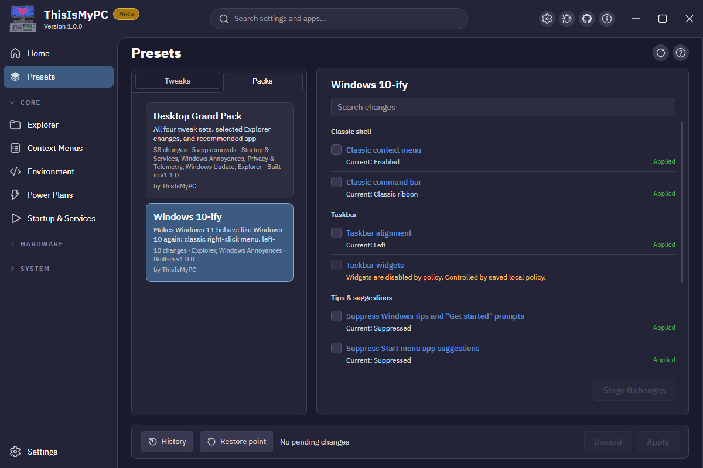

<div align="center">


# ThisIsMyPC

### Debloat Windows entirely. Stop anything unwanted, control updates and telemetry, and manage all your hardware. Take control of your PC.

[](#quick-start)
[](global.json)
[](CONTRIBUTING.md)
[](LICENSE)
[](https://github.com/samboland/thisismypc/actions/workflows/ci.yml)

Native Windows app. Free and open source.

[Quick start](#quick-start) · [What you can control](#what-you-can-control) · [How changes work](#how-changes-work) · [FAQ](#faq) · [Contributing](CONTRIBUTING.md)



</div>

---

You paid for it. Maybe you even built it yourself. Controlling it should not take a dozen apps and a digital sparring match with a multibillion dollar corporation.

ThisIsMyPC brings together years of effort by like-minded developers and Windows users with one goal in mind: Actually owning your hardware, inside-out.

Open source, free and yours forever. No accounts, no telemetry. Only the things you ask for. Set it up your way, and it'll stay that way.

Say it with me.<br>
**This is MY PC.**

## Quick start

**Development preview. The first release is still in development. There is no published installer yet.**

You can build the app, explore the code, and help test it now.
Live installation, hardware coverage, and some Apply and undo checks remain pending.
The [backlog](docs/planning/refinement-backlog.md) records completed work and remaining checks.

### Ask your coding agent

Open this repository in your coding agent and ask:

```text
Set up ThisIsMyPC on this Windows PC. Read AGENTS.md, check prerequisites,
run Setup.ps1, and run the CI-safe tests. Explain any failed checks.
Do not launch the app or apply Windows changes until I ask.
```

The repo includes shared instructions for coding agents.
Your agent can inspect the setup, build the app, and help investigate problems using the same source.

### Build it yourself

Use Windows 11 x64, Git, and the exact .NET SDK in [global.json](global.json), currently `10.0.400`.
In PowerShell:

```powershell
git clone https://github.com/samboland/thisismypc.git
cd thisismypc
.\Setup.ps1
dotnet run --project src/ThisIsMyPC.App
```

Setup checks prerequisites, initializes the OpenRGB submodule, installs repo hooks, builds the .NET solution, and runs CI-safe tests.
The C++ lighting engine needs a separate build with the Visual Studio C++ tools.
See [development setup](CONTRIBUTING.md) and the [lighting build guide](docs/lighting-controllers.md#build).

The app requests administrator permission for its Broker at startup.
Changes stay staged until you review and approve them.
Start by browsing the pages and trying staging and discard.
See [preview testing](docs/testing/preview-testing.md) for checks and useful bug reports.

Signed installers will appear on the [Releases page](https://github.com/samboland/thisismypc/releases).

## What you can control

| Area | Pages | What you can do |
|---|---|---|
| Windows desktop | Explorer, Context Menus | Change taskbar and Explorer preferences; inspect and disable registered right-click handlers. |
| Apps and startup | Software, Startup & Services | Install, remove, and update apps through winget; inspect startup entries and services. |
| Environment and power | Environment, Power Plans | Edit user and system variables, including PATH; choose and adjust power plans. |
| Windows behavior | Windows Annoyances, Windows Update, Privacy & Telemetry | Control suggestions, ads, update behavior, and supported privacy settings. |
| Security | Security | Manage supported sign-in, antivirus, app protection, and notification settings. |
| Network | Network & Firewall | Inspect adapters and firewall rules; stage connection state, IPv4 DNS, and firewall profile changes. |
| Display | Display | Adjust supported monitors through DDC/CI. |
| Laptop controls | System Control | Open maintained G-Helper controls on supported laptops. |
| RGB lighting | Lighting | Control supported devices through the bundled engine built from OpenRGB. |
| Fan profiles | Cooling | Edit saved FanControl profiles; runtime activation still needs verification. |
| Sensors | Monitoring | View supported memory, NVIDIA GPU, and basic battery readings with short history graphs. |

Availability depends on your Windows edition, policy state, and hardware.
Monitoring does not yet cover CPU, motherboard, storage, AMD GPU, or Intel GPU sensors.
Network & Firewall includes initial controls; complete firewall rule editing remains planned.

### Start with a preset

Presets group related choices, including **Nuke Copilot**, **Privacy Baseline**, **Windows 10-ify**, and **Windows Update Control**.
You can inspect and change each choice before staging it.

On desktop PCs, the **Intro guide** explains the modules and helps build a **Desktop Grand Pack**.
The pack combines 58 settings and five app removal choices.
App removals use a separate action queue and do not support undo.

### Make one change

Find a setting by page or search, choose its value, and review the pending list.
The app captures the previous value before staging a reversible change.
After Apply, History records its result and provides undo for reversible changes.

### Keep supported choices applied

Optional **Owner Mode** restores explicitly chosen, supported preferences through a SYSTEM service.
Consent defaults off, and saved choices belong to one verified Windows account.
The current catalog includes eleven non-policy DWORD preferences from Windows Annoyances.

Owner Mode can restore outside edits too. Pause it before changing a protected preference with another tool.
Installed-service live evaluation remains pending.
See [Owner Mode controls](docs/owner-mode-service-controls.md) for its limits.

## How changes work

1. **Choose.** Edits enter a pending list with their captured before-state.
2. **Review.** Inspect the settings and system locations before approving the batch.
3. **Apply.** Each reversible change group rolls back if it fails. Earlier completed groups remain applied.
4. **Undo.** History stores reversible changes and their previous values.

Installs, uninstalls, and upgrades run through a separate action queue.
They have no fabricated before-state or generic undo.
The app requests a restore point when at least five eligible changes and actions are pending.

The UI runs unelevated. A separate elevated Broker performs privileged changes.
Owner Mode uses a service and shares protected recovery with the Broker.

### Inspect the source behind a release

Release tooling pins the inputs that affect installer contents.
The verifier checks signatures and compares installed files against a build of the exact source tag.
It does not run or modify the downloaded installer.

```powershell
.\tools\verify-release.ps1 -ReleasedInstaller "C:\path\to\ThisIsMyPC-Installer-<version>.exe"
```

Verification requires the pinned Windows build environment.
See [release packaging](docs/release/packaging.md) for prerequisites, evidence, and failure meanings.
The release keys are published in [update signing](docs/release/update-signing.md).

## FAQ

<details>
<summary><strong>Can I download an installer today?</strong></summary>

There is no published release yet. Use the source setup above for preview testing.
The first release still needs the checks recorded in the backlog.

</details>

<details>
<summary><strong>Do I need an AI app to use ThisIsMyPC?</strong></summary>

No. ThisIsMyPC is a native Windows app. Coding agents help develop, build, and investigate it.
You can also build it with the commands above.

</details>

<details>
<summary><strong>Does it upload my PC data?</strong></summary>

The app has no account requirement or telemetry.
The app checks GitHub Releases for updates by default; Settings lets you disable that check.
Software operations use winget, and companion applications have their own network behavior.
UI settings and History stay in your user data folder.
Owner Mode state stays in protected machine storage.

</details>

<details>
<summary><strong>Does every action support undo?</strong></summary>

Reversible settings capture their previous state and support History undo.
Software installs, removals, and upgrades do not.
Owner Mode restoration records also do not support generic undo.

</details>

<details>
<summary><strong>Does it support Windows 10 or every PC?</strong></summary>

The current target is Windows 11 x64.
Windows 10 is declared in the manifest but remains untested.
Hardware controls depend on device support; unavailable controls show a reason.

</details>

## Contributing

[Report a bug](https://github.com/samboland/thisismypc/issues/new?template=bug-report.md), suggest a change, or help test a preview.
Include what you clicked, what you expected, and what happened.
Screenshots of confusing controls are useful too.

For code changes, start with [CONTRIBUTING.md](CONTRIBUTING.md) and [AGENTS.md](AGENTS.md).
Agents use the same build, test, and screenshot workflow as the maintainer.
Agree substantial changes in an issue before implementing them.

This repository is developed with AI coding agents under Sam Boland's direction.
The documentation includes agent-written material.

## Documentation

- [Documentation index](docs/README.md): design notes, system behavior, and testing guides.
- [Development setup](CONTRIBUTING.md): prerequisites, builds, tests, and contribution workflow.
- [Preview testing](docs/testing/preview-testing.md): checks you can try and how to report a problem.
- [Backlog](docs/planning/refinement-backlog.md): current progress and unverified behavior.
- [Release plan](docs/planning/v1-completion-plan.md): the scope of the first release.
- [Release packaging](docs/release/packaging.md): signing and source verification.

## License and credits

[GPLv3, version 3 only](LICENSE), for every component, including the Owner Mode service.
Copyright (c) 2026 No More Secrets, LLC. See [NOTICE](NOTICE).

Lighting uses [OpenRGB](https://openrgb.org), built from pinned source under GPL-2.0-or-later, and includes PawnIO SMBus modules.
[G-Helper](https://github.com/seerge/g-helper) and [FanControl](https://github.com/Rem0o/FanControl.Releases) remain maintained companion applications.
See [why GPLv3](docs/why-gplv3.md), [lighting controllers](docs/lighting-controllers.md), and [hardware integration](docs/research/hardware-integration-boundaries.md) for attribution and boundaries.
